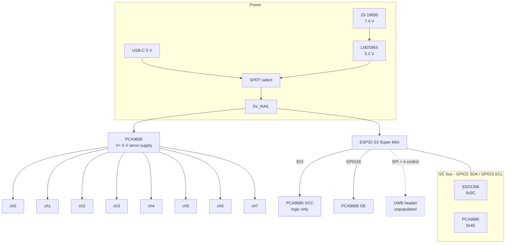

# Wiring specification

Everything needed to build the harness for the PCA9685-based Sesame robot.

Start here, then work from the [netlist](netlist.md) — that is the document
you actually solder from. Everything else exists to explain it.

## Why PCA9685

Upstream offers three routes: the Sesame Distro Board V1, the V3, or hand
wiring to MCU pins. None fits a swarm build. The Distro Boards are a fixed
design we cannot extend with the pins UWB positioning needs, and hand wiring
puts eight servo PWM channels on the MCU — consuming timers and putting servo
current uncomfortably close to the logic supply.

Moving PWM generation onto a PCA9685 frees the MCU's timers entirely, keeps
servo current on its own supply, and leaves GPIOs available for the UWB header
and extra actuators.

## Block diagram

## Documents

| Document | Read it when |
|---|---|
| [netlist.md](netlist.md) | You are soldering. The source of truth |
| [pin-map.md](pin-map.md) | You need to know what a GPIO does, or want to assign a new one |
| [power.md](power.md) | Before first power-on, and before adding any load |
| [expansion.md](expansion.md) | Adding a UWB module or using the spare PWM channels |
| [antenna.md](antenna.md) | Seating the board, laying out a PCB, or closing a chassis |
| [diagrams/](diagrams/README.md) | You want a pictorial view, or to compare against the Loftwork bench scheme |

## Assembly order

Each step names the netlist rows it satisfies, so progress is checkable
against the source of truth rather than by eye.

Before any of it: **seat the ESP32 so its antenna end overhangs the end of
the breadboard.** Seated over the metal contact strips, the radio still
receives but cannot be reached, which presents as a dead board rather than a
placement mistake. See [antenna.md](antenna.md).

1. **Set the LM2596S to 5.2 V with no load.** Nothing connected downstream.
   Rows 3–4. Full procedure in [power.md](power.md).
2. **Build the 5 V rail and the ground star.** Rows 1–11.
3. **Measure the rail before connecting any module.** It must read 5.2 V. A
   wrong reading costs nothing now and costs a board later.
4. **Wire logic and I2C.** Rows 12–18.
5. **Confirm both devices enumerate** — `0x3C` and `0x40` must both appear on
   an I2C scan — *before* attaching any servo.
6. **Attach servos one channel at a time**, ch0 through ch7. Rows 19–26.
   Verify each moves the leg you expect before adding the next.
7. **Leave the UWB header unpopulated.** Rows 27–34 are landed pads only.

Steps 3 and 5 are the cheap checks that catch mistakes while they are still
free. Do not skip them to save time; they exist because the failure they catch
is otherwise discovered by smoke.

## Pre-power checklist

- [ ] LM2596S output measured at 5.2 V **with no load connected**
- [ ] Polarity verified at every connector, including the battery plug
- [ ] PCA9685 `VCC` is on the **3V3** net, not on `V+` — confirm by tracing the
      wire, not by looking at the colour
- [ ] ESP32 `5V` comes from the rail node, **not** from the PCA9685 `V+`
      terminal
- [ ] ESP32 antenna end clear of metal and overhanging the breadboard —
      see [antenna.md](antenna.md)
- [ ] No servos connected yet
- [ ] Battery disconnected while any soldering is done

## Safety

Three mistakes destroy hardware here. They are worth stating once, plainly:

1. **Wiring 5 V into PCA9685 `VCC`.** `VCC` is the 3.3 V logic supply; `V+` is
   the 5 V servo supply. They are different nets on the same board, adjacent
   on the terminal block.
2. **Powering the ESP32 through the PCA9685's `V+` terminal.** This puts servo
   current through the MCU's supply path. Take the 5 V branch from the rail
   node.
3. **Connecting an unadjusted LM2596S.** These ship at an arbitrary output
   voltage. Set it before it is connected to anything, not after.

Beyond those: never solder with the battery connected, and do not substitute
an unprotected battery pack — this design has no undervoltage cutoff of its
own.
