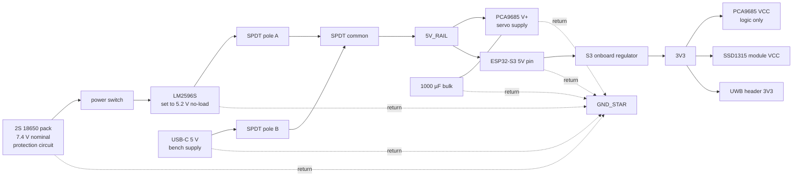

# Power rail design

Defines the three net names the [netlist](netlist.md) wires against:
`5V_RAIL`, `GND_STAR`, and `3V3`. Use these identifiers exactly.

## Topology

`5V_RAIL` branches **twice** from the rail node. The ESP32's 5 V feed is one
of those branches — it is never chained off the PCA9685's `V+` terminal.

## The four rules

**1. SPDT switch, not a diode-OR.**
A physical changeover switch makes it impossible for the two sources to be
connected at once, so neither can backfeed the other. A diode-OR would also
prevent backfeed, but costs roughly 0.3 V across a Schottky — and it costs it
precisely when the rail is already sagging under servo load, which is the
moment the margin is needed.

**2. Star topology at `GND_STAR`.**
Every return lands on one node rather than daisy-chaining through modules.
Servo current is the loudest thing in the system; if it shares a return
segment with the MCU, its IR drop moves the MCU's ground reference and the
board browns out or resets under load.

**3. 1000 µF bulk capacitance at PCA9685 `V+`.**
Eight MG90S servos starting together draw an inrush the buck converter cannot
answer quickly enough. The bulk cap supplies that transient locally. It sits
at `V+` because that is where the current is drawn — placing it at the buck
output instead leaves the wiring inductance between it and the load.

**4. Set the LM2596S to 5.2 V with no load, before connecting anything.**
These modules ship at an arbitrary factory output voltage. Connecting an
ESP32 to one straight out of the bag is how boards die.

The 5.2 V target is deliberate, not a typo for 5.0 V. It offsets the sag
expected under simultaneous servo load so the rail settles near 5 V in
practice.

## LM2596S adjustment procedure

Do this once, before the module is connected to anything downstream.

1. Connect the battery to the LM2596S `IN+` / `IN−` only. Leave `OUT+` and
   `OUT−` completely unconnected.
2. Set a multimeter to DC volts and put it across `OUT+` and `OUT−`.
3. Power on.
4. Turn the trim potentiometer and watch the meter. It is multi-turn — expect
   many turns before the reading moves, and do not force it past either stop.
5. Adjust until the meter reads **5.2 V**.
6. Power off, then confirm: power on again and re-read. It must still show
   5.2 V before anything else is connected.

Only after step 6 reads correctly may the rail be built.

## Power budget

| Item | Draw |
|---|---|
| 8 × MG90S, moving simultaneously | ≈ 2.5 – 3 A peak |
| LM2596S continuous rating | ≈ 2 A |
| LM2596S peak rating | 3 A |

The peak servo demand already exceeds the converter's continuous rating. This
works because all eight servos rarely stall at once and the bulk cap covers
the transients — it is not comfortable headroom.

Two additions would each require re-checking this budget rather than assuming
it still holds:

- populating the reserved output **ch8**
- fitting the UWB module (≈ 150 mA peak during transmit)

Doing both at once on this converter is not supported by these numbers.

## Battery

2S 18650, 7.4 V nominal — 8.4 V fully charged, roughly 6.0 V at cutoff. The
pack carries its own protection circuit and terminates in an XH2.54-2P plug.
It charges over USB.

**Undervoltage protection is the pack's responsibility.** This design adds
none of its own, so do not substitute an unprotected pack.

Loftwork's bench notes specify 2S 14500 cells at the same 7.4 V. Those are
electrically interchangeable here, differing only in capacity and physical
size. 18650 is the chosen part for this build.

## Safety

- **Never solder with power connected.** Disconnect the battery first.
- **Verify polarity before first power-on**, at every connector.
- **Measure the rail before attaching any module.** A rail that reads wrong
  costs nothing to fix at this point and costs a board afterwards.
- `PCA9685 VCC` is the **3V3 logic** net. It is *not* `V+`. Wiring 5 V into
  `VCC` destroys the PCA9685. This distinction is restated in every document
  that mentions `V+` because it is the single easiest way to lose hardware
  here.
