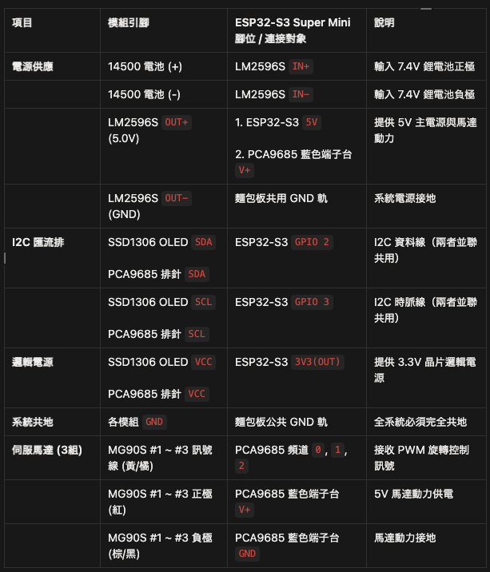
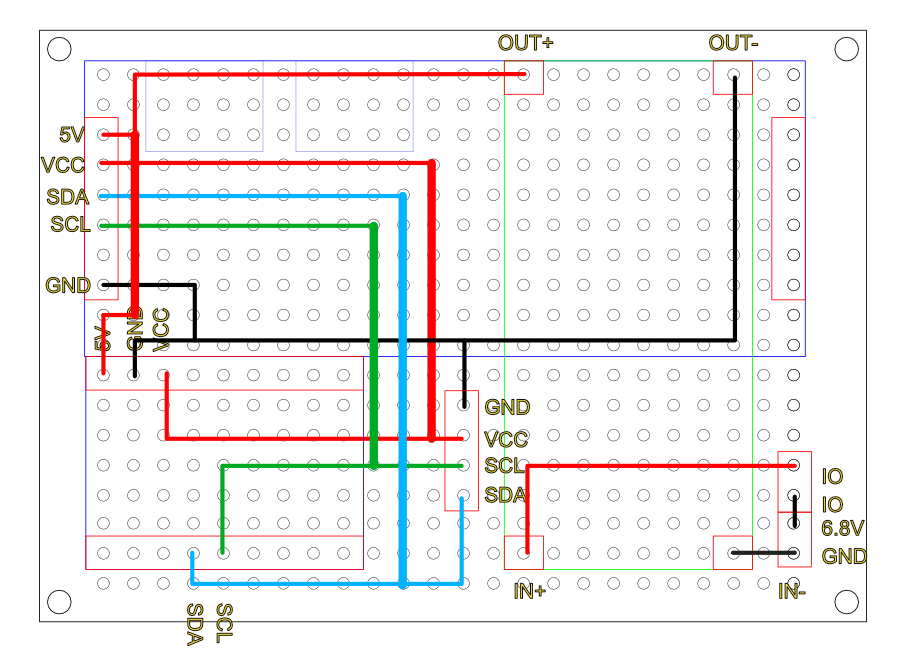

# Stage 1 as-built perfboard

## Status

This is the colleague-built Stage 1 bench assembly, without UWB. It verified
power-up, I2C on GPIO2/GPIO3, and movement of three servos on PCA9685 channels
0–2.

It does not verify all eight servos, simultaneous servo load, complete
animation playback, Wi-Fi in the photographed stacked placement, UWB, or exact
agreement of hidden underside wiring with the production netlist.

## Verified wiring table

The colleague-tested connections transcribed from the wiring table are:

| Function | Connection |
|---|---|
| Battery input | 7.4 V 2S 14500 positive and negative to LM2596S `IN+` and `IN-` |
| Main 5 V supply | LM2596S `OUT+`, adjusted to 5.0 V, to ESP32-S3 `5V` and PCA9685 servo `V+` |
| Main ground | LM2596S `OUT-` to the shared perfboard ground rail and every module ground |
| I2C data | SSD1306 `SDA` and PCA9685 `SDA` to ESP32-S3 GPIO2 |
| I2C clock | SSD1306 `SCL` and PCA9685 `SCL` to ESP32-S3 GPIO3 |
| Logic supply | SSD1306 `VCC` and PCA9685 logic `VCC` to ESP32-S3 `3V3(OUT)` |
| Servo signals | MG90S servos 1–3 signal wires to PCA9685 channels 0, 1, and 2 |
| Servo power | Servos 1–3 red wires to PCA9685 `V+`; brown/black wires to PCA9685 `GND` |

The PNG wiring table specifies a 7.4 V battery input. The separate 6.8 V
captured-condition annotation appears on
`20260901_CircuitBoardDesign_002_Fixed.jpg`, not on the PNG table; neither image
is a battery specification. The colleague-tested LM2596S output is 5.0 V. For new construction, follow the
production power setup and safety procedure in
[`../../docs/wiring/power.md`](../../docs/wiring/power.md).

## Perfboard routing and placement

The layout is the physical routing and placement reference for the tested
board. It shows rail routing and intended module locations, but does not prove
underside continuity or every installed connection. The ESP32-S3 Super Mini is
at the lower-left, the LM2596S is rotated at the right, and the PCA9685 is
stacked across the upper part of the carrier.

Additional top, oblique, underside, and module-placement evidence is in
[`photos/`](photos/).

## Antenna warning

The photographed ESP32 antenna end does not overhang the carrier and sits near
the stacked PCA9685. This placement is radio-unverified and does not satisfy
the production keep-out in
[`../../docs/wiring/antenna.md`](../../docs/wiring/antenna.md).

## Authority

These images and this transcription are bench evidence, not a soldering
netlist. New construction uses
[`../../docs/wiring/netlist.md`](../../docs/wiring/netlist.md); where evidence
or a pictorial guide disagrees with the netlist, the netlist wins.
